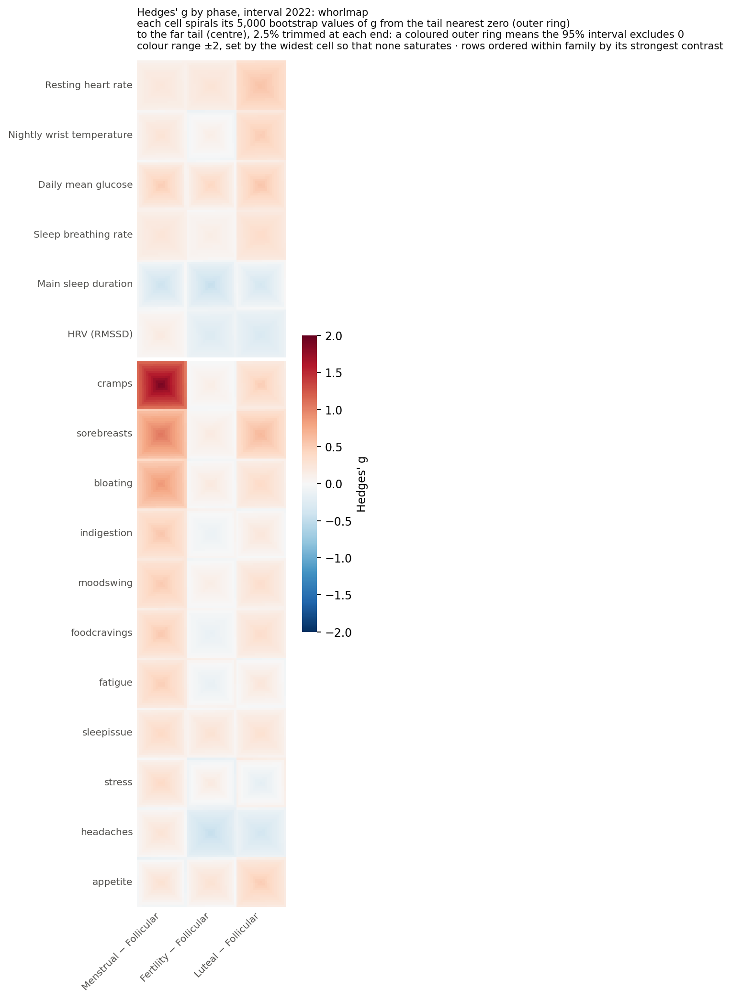

# phaseffect

How much does the menstrual phase move wearable metrics and symptoms, and does a person's own shift repeat across her cycles? Effect sizes with 95 % intervals from interval 2022 of the [mcPHASES](https://physionet.org/content/mcphases/1.0.0/) dataset: 42 participants, Fitbit Sense, Dexcom CGM, Mira urine hormones, daily diary. Every contrast is within the same participants against their own follicular days.

**Site:** https://sangyu.github.io/phaseffect · Cohort aggregates only; no participant-level value, identifier or date appears anywhere in this repository.

## Cohort shifts by phase

Luteal − follicular, same participants: resting heart rate **+3.0 bpm** [2.2, 3.8], wrist temperature **+0.23 °C** [0.12, 0.31], glucose **+0.16 mmol/L** [0.06, 0.27], breathing rate +0.48 /min, HRV −3.9 ms. Menses is the symptom phase: cramps +1.1 points, 41 of 42 participants higher. [Page →](https://sangyu.github.io/phaseffect/cohort-shifts.html)

Whorlmap of Hedges' g for comparison across metrics: each cell spirals its bootstrap from the tail nearest zero (outer ring) to the far tail (centre); a coloured outer ring means the 95 % interval excludes zero.

## Does a person's shift persist?

The average contrast is clear; whether people differ persistently in it is not settled. A three-level model (person, cycle, day) makes resting heart rate a candidate: its between-person SD of **1.9 bpm** on a 3.0 bpm average is larger than most simulated no-difference cohorts produce. The other four metrics are uninformative: temperature, breathing rate and HRV fit on a model boundary, and glucose is indistinguishable from no difference. Intervals are withheld until calibrated by simulation. [Page →](https://sangyu.github.io/phaseffect/repeatability.html)

## Context

[Prior findings](https://sangyu.github.io/phaseffect/prior-findings.html): the 17 works that have used this dataset, what each established, and the data hazards they report. For this dataset, no published work gives resting-heart-rate, breathing-rate or HRV phase contrasts in native units, or splits a phase contrast into person, cycle and day variation; luteal changes in these metrics are well established in other wearable studies. [Methods](https://sangyu.github.io/phaseffect/methods.html) in one screen.

## What is here

| Path | Content |
|---|---|
| `*.qmd`, `_quarto.yml`, `styles.css` | The site. Render with `quarto render` (Quarto ≥ 1.4) |
| `docs/` | Rendered site, served by GitHub Pages |
| `tables/` | Cohort-level tables: effect sizes for 51 cells, variance components per metric, per-feature ICCs, the repeatability summaries |
| `figures/` | Figures. `P*` come from the analysis runs (DABEST half-violins and whorlmap cells are cohort bootstraps); `F2` and `F3` are redrawn from `tables/` by `scripts/make_figures.py` (pandas, matplotlib) |

## Data and licences

The dataset is restricted-access on PhysioNet. Cite the dataset record ([Lin et al. 2025, PhysioNet, doi:10.13026/zx6a-2c81](https://doi.org/10.13026/zx6a-2c81)), the platform ([Pollard et al. 2026, *Nature Health*](https://doi.org/10.1038/s44360-026-00096-z)) and the descriptor ([Lin et al. 2026, *Scientific Data*](https://doi.org/10.1038/s41597-026-06805-3)). The analysis code that reads it is released separately. Code here: see `LICENSE`. Text and figures made here: © Sangyu Xu 2026. Reproduced published figures keep their own licences, stated in their captions.
