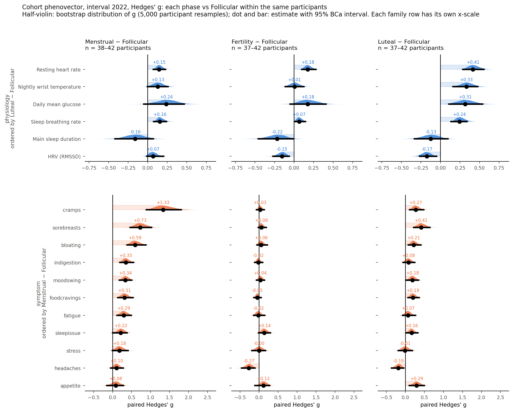

Positive means higher than on the participant's own follicular days. Paired mean differences with 95 % bias-corrected bootstrap intervals over 5,000 participant resamples ([methods](methods.qmd)). In the same participants the luteal phase moves five of the six device metrics (sleep duration's luteal interval includes zero, −0.10 h [−0.25, 0.07]); menses moves the symptoms. The luteal directions of resting heart rate, breathing rate and HRV agree with independent wearable cohorts ([Shilaih et al. 2017](https://doi.org/10.1038/s41598-017-01433-9) for pulse rate; [Jasinski et al. 2024](https://doi.org/10.1038/s41746-024-01394-0); [Heneghan et al. 2026](https://doi.org/10.1177/17455057261503611): about 3.0 bpm, 0.6 /min and 6 ms) and with a meta-analysis of mostly laboratory recordings of vagal activity ([Schmalenberger et al. 2019](https://doi.org/10.3390/jcm8111946)); temperature agrees with [Goodale et al. 2019](https://doi.org/10.2196/13404). Resting heart rate, temperature and glucose also agree with earlier analyses of largely the same participants, so these corroborate rather than replicate them: [Lin et al. 2023](https://doi.org/10.1038/s41746-023-00884-x) reported the luteal glucose rise as 0.15 mmol/L [0.09, 0.20] (0.16 [0.10, 0.22] after adjustment) in 49 participants, at least 41 of them among these 42, and tested five of these symptoms across phases. This page adds one estimator for every metric and symptom: paired within-participant contrasts in native units with bootstrap intervals, side by side, as a common baseline for asking whether a person's shift recurs across cycles ([repeatability](repeatability.qmd)).

## Device metrics

| Metric | n | Menstrual − Follicular | Fertility − Follicular | Luteal − Follicular | Higher in luteal |
|---|---|---|---|---|---|
| Resting heart rate (bpm) | 42 | +1.07 [0.57, 1.57] | +1.24 [0.70, 1.91] | **+3.01 [2.22, 3.79]** | 37 of 42 |
| Nightly wrist temperature (°C) | 42 | +0.09 [0.00, 0.16] | +0.00 [−0.08, 0.07] | **+0.23 [0.12, 0.31]** | 35 of 42 |
| Daily mean glucose (mmol/L) | 40–41 | +0.13 [−0.02, 0.25] | +0.08 [−0.02, 0.19] | **+0.16 [0.06, 0.27]** | 28 of 40 |
| Sleep breathing rate (/min) | 37–38 | +0.30 [0.18, 0.41] | +0.13 [0.03, 0.31] | **+0.48 [0.35, 0.63]** | 33 of 37 |
| HRV, RMSSD (ms) | 37–38 | +1.6 [−0.2, 4.6] | −3.4 [−5.8, −1.7] | **−3.9 [−5.6, −1.9]** | 7 of 37 |
| Main sleep duration (h) | 42 | −0.13 [−0.31, 0.05] | −0.17 [−0.35, −0.01] | −0.10 [−0.25, 0.07] | 15 of 42 |

## Symptoms, points on the 0–5 scale

| Symptom | Menstrual − Follicular | Fertility − Follicular | Luteal − Follicular |
|---|---|---|---|
| cramps | **+1.14 [0.92, 1.40]**, 41 of 42 higher | +0.02 | **+0.23 [0.11, 0.35]** |
| sore breasts | **+0.59 [0.43, 0.81]** | +0.05 | **+0.35 [0.20, 0.55]** |
| bloating | **+0.66 [0.44, 0.94]** | +0.06 | **+0.24 [0.09, 0.42]** |
| indigestion | **+0.38 [0.22, 0.57]** | −0.02 | +0.08 [−0.06, 0.24] |
| mood swings | **+0.36 [0.20, 0.52]** | +0.04 | **+0.19 [0.04, 0.36]** |
| food cravings | **+0.34 [0.15, 0.56]** | −0.05 | **+0.21 [0.08, 0.37]** |
| fatigue | **+0.28 [0.12, 0.50]** | −0.02 | +0.07 [−0.07, 0.25] |
| sleep issues | **+0.21 [0.02, 0.38]** | +0.15 [−0.01, 0.32] | **+0.16 [0.03, 0.32]** |
| stress | **+0.18 [0.00, 0.39]** | −0.00 | −0.01 |
| headaches | +0.10 [−0.05, 0.28] | **−0.28 [−0.45, −0.12]** | **−0.19 [−0.35, −0.05]** |
| appetite | +0.04 | +0.05 | **+0.14 [0.05, 0.22]** |

## Standardized, to compare across metrics

Hedges' g uses the spread of participants' phase means as its unit, so a consistent 3 bpm shift against baselines that differ by 7 bpm between people scores lower than a one-point symptom shift against baselines that differ by less than a point. Use it to compare cells, not to size an effect.

## Read with

- **Reference phase.** The app's "Follicular" label is the late-follicular phase, from the last day of flow to the first day of the fertile window, the same definition the dataset's papers use ([Lin et al. 2023](https://doi.org/10.1038/s41746-023-00884-x); [Lin et al. 2024](https://doi.org/10.1038/s44294-024-00037-9); [Lin et al. 2026](https://doi.org/10.1038/s41597-026-06805-3)). In this release it is short (a median of 6 labelled days here; the papers report means of 7.7–11 days). The papers analysed largely the same participants with other estimators, so agreement with them is corroboration, not replication.
- **Open cycles included.** Days in cycles that never closed count towards their labelled phase. Restricted to closed cycles and estimated by a mixed model of daily values (both the subset and the estimator change), the luteal contrasts agree for resting heart rate (+3.0 bpm), temperature (+0.28 °C), glucose (+0.21 mmol/L) and breathing rate (+0.53 /min); HRV is smaller there (−2.5 ms against −3.9), so its size depends on that choice.
- **Multiplicity.** 51 exploratory cells, no adjustment; 30 exclude zero. Read them as estimates, not as 30 discoveries. With no phase effect anywhere, about 2.5 cells would exclude zero on average; because the cells are correlated (the symptoms strongly), the count by chance can be much larger, so the excess is not a count of real effects.
- **Not blind.** Participants saw the app's phase predictions while reporting symptoms.
- **Symptoms studied before.** [Lin et al. 2023](https://doi.org/10.1038/s41746-023-00884-x) tested bloating, food cravings, sleep issues, fatigue and appetite across these phases, and [Kogelman et al. 2026](https://doi.org/10.64898/2026.08.07.743463) modelled daily symptom intensity across phases defined from LH, in 35 of these participants. The contrasts here re-estimate them as paired differences on the 0–5 scale, beside the physiology; they are not first evidence of phase-linked symptoms.
- **Which contrast leads.** Device metrics are ordered by the luteal contrast and symptoms by the menstrual one: in each family, the contrast with the largest summed |g|. The luteal label spans 10–14 days, so it averages early-luteal days with the premenstrual days on which symptoms rise.
- **Disagreements.** An independent CGM preprint found no change in mean glucose across the cycle ([Aharoni et al. 2026](https://doi.org/10.64898/2026.10.14.26365513), 209 women around 43 years old); the glucose rise here rests on this study's participants. The dataset descriptor says wrist temperature rose during the fertile window; here fertile-window − follicular temperature is +0.00 °C [−0.08, 0.07], in line with Goodale et al. 2019 rather than the descriptor.
- **Data handling.** 782 of 3,698 resting-heart-rate days were coded 0 and treated as missing; 53 of 3,097 breathing-rate nights coded 0 were treated as missing; 90 HRV values at or below 0 were kept (a rule is still owed); two participants' glucose was converted from mg/dL and 150 of 3,109 glucose days with under 12 hours of readings were dropped; 16 of 3,258 temperature nights were dropped as artefacts. Whether these exclusions differ by phase is not yet reported.

Table: [`tables/cohort_phenovector.csv`](tables/cohort_phenovector.csv), 51 rows, no identifiers.
