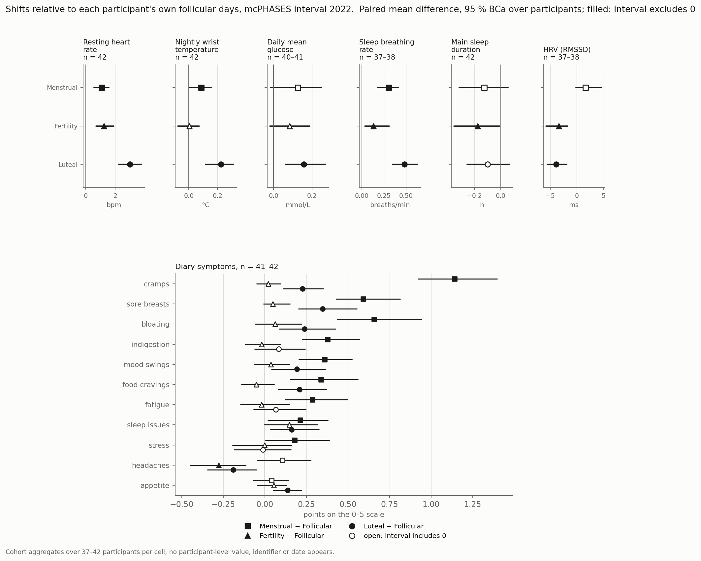
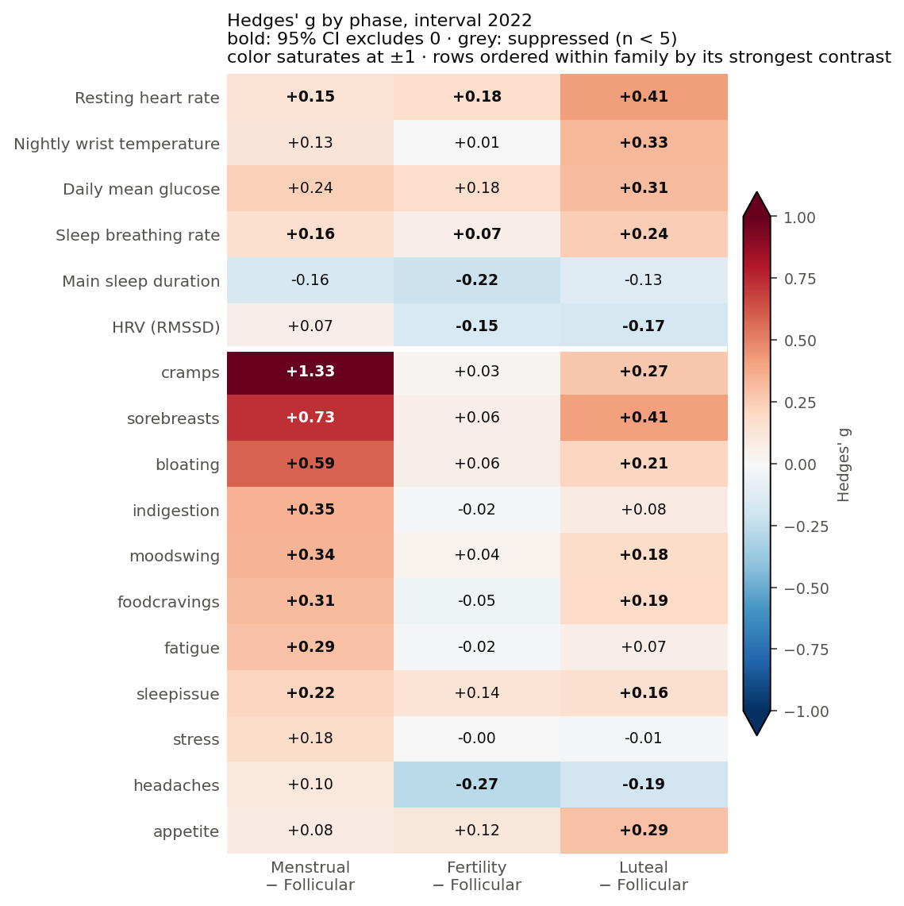
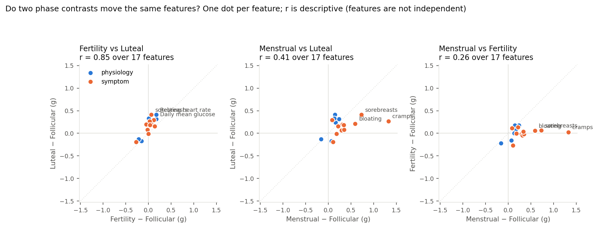

Positive means higher than on the participant's own follicular days. Paired mean differences with 95 % bias-corrected bootstrap intervals over 5,000 participant resamples ([methods](methods.qmd)). The luteal phase moves every device signal in the same participants; menses moves the symptoms.

## Device signals

| Signal | n | Menstrual − Follicular | Fertility − Follicular | Luteal − Follicular | Higher in luteal |
|---|---|---|---|---|---|
| Resting heart rate (bpm) | 42 | +1.07 [0.57, 1.57] | +1.24 [0.70, 1.91] | **+3.01 [2.22, 3.79]** | 37 of 42 |
| Nightly wrist temperature (°C) | 42 | +0.09 [0.00, 0.16] | +0.00 [−0.08, 0.07] | **+0.23 [0.12, 0.31]** | 35 of 42 |
| Daily mean glucose (mmol/L) | 40–41 | +0.13 [−0.02, 0.25] | +0.08 [−0.02, 0.19] | **+0.16 [0.06, 0.27]** | 28 of 40 |
| Sleep breathing rate (/min) | 37–38 | +0.30 [0.18, 0.41] | +0.13 [0.03, 0.31] | **+0.48 [0.35, 0.63]** | 33 of 37 |
| HRV, RMSSD (ms) | 37–38 | +1.6 [−0.2, 4.6] | −3.4 [−5.8, −1.7] | **−3.9 [−5.6, −1.9]** | 7 of 37 |
| Main sleep duration (h) | 42 | −0.13 [−0.31, 0.05] | −0.17 [−0.35, −0.01] | −0.10 [−0.25, 0.07] | 15 of 42 |

## Symptoms, points on the 0–5 scale

| Symptom | Menstrual − Follicular | Fertility − Follicular | Luteal − Follicular |
|---|---|---|---|
| cramps | **+1.14 [0.92, 1.40]**, 41 of 42 higher | +0.02 | **+0.23 [0.11, 0.35]** |
| sore breasts | **+0.59 [0.43, 0.81]** | +0.05 | **+0.35 [0.20, 0.55]** |
| bloating | **+0.66 [0.44, 0.94]** | +0.06 | **+0.24 [0.09, 0.42]** |
| indigestion | **+0.38 [0.22, 0.57]** | −0.02 | +0.08 [−0.06, 0.24] |
| mood swings | **+0.36 [0.20, 0.52]** | +0.04 | **+0.19 [0.04, 0.36]** |
| food cravings | **+0.34 [0.15, 0.56]** | −0.05 | **+0.21 [0.08, 0.37]** |
| fatigue | **+0.28 [0.12, 0.50]** | −0.02 | +0.07 [−0.07, 0.25] |
| sleep issues | **+0.21 [0.02, 0.38]** | +0.15 [−0.01, 0.32] | **+0.16 [0.03, 0.32]** |
| stress | +0.18 [0.00, 0.39] | −0.00 | −0.01 |
| headaches | +0.10 [−0.05, 0.28] | **−0.28 [−0.45, −0.12]** | **−0.19 [−0.35, −0.05]** |
| appetite | +0.04 | +0.05 | **+0.14 [0.05, 0.22]** |

## Standardized, to compare across signals

Hedges' g uses the spread of participants' phase means as its unit, so a consistent 3 bpm shift against baselines that differ by 7 bpm between people scores lower than a one-point symptom shift against baselines that differ by less than a point. Use it to compare cells, not to size an effect.

## Read with

- **Reference phase.** Mira's "Follicular" label is short (median 6 days) and excludes menses and the fertile window. Published contrasts use a late-follicular reference, so agreement with them is same-direction, not replication.
- **Open cycles included.** Days in cycles that never closed count towards their labelled phase; a closed-cycle sensitivity run is pending.
- **Multiplicity.** 51 cells, no adjustment. 36 exclude zero; two or three would by chance. Symptom cells are strongly correlated with each other.
- **Not blind.** Participants saw the app's phase predictions while reporting symptoms.
- **Data handling.** 782 of 3,698 resting-heart-rate days were coded 0 and treated as missing; two participants' glucose was converted from mg/dL; 16 of 3,258 temperature nights were dropped as artefacts.

Table: [`tables/cohort_phenovector.csv`](tables/cohort_phenovector.csv), 51 rows, no identifiers.
