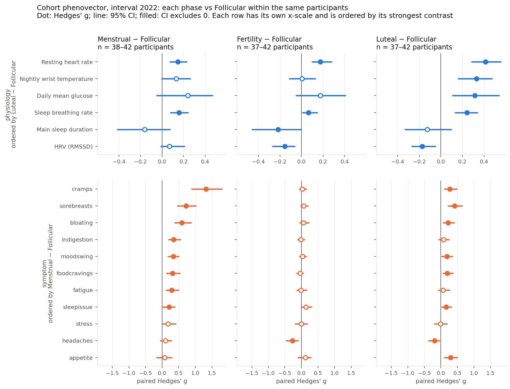
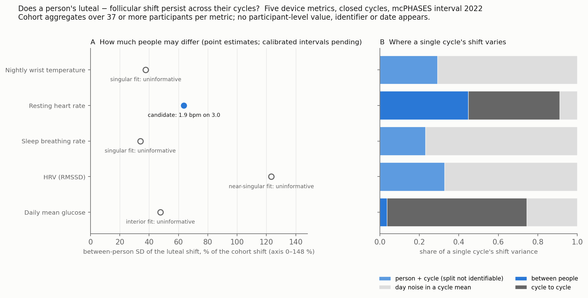

Interval 2022 of the [mcPHASES](https://physionet.org/content/mcphases/1.0.0/) dataset: 42 participants, Fitbit Sense, Dexcom CGM, Mira urine hormones and a daily diary over about three months. Phases are the Mira app's labels, estimated from urinary LH and E3G and self-reported flow; ovulation is not confirmed. Every contrast is within the same participants, against their own follicular days, and is reported as an effect size with a 95 % interval on the linked pages. Nothing on this site is participant-level.

::: {.grid}

::: {.g-col-12 .g-col-md-6}
### [Cohort shifts by phase](cohort-shifts.qmd)

Luteal − follicular, same participants: resting heart rate **+3.0 bpm** [2.2, 3.8], wrist temperature **+0.23 °C** [0.12, 0.31], glucose **+0.16 mmol/L** [0.06, 0.27], breathing rate +0.48 /min, HRV −3.9 ms. Menses is the symptom phase: cramps +1.1 points, 41 of 42 participants higher. The luteal rises in resting heart rate, temperature and glucose agree with earlier analyses of largely the same participants ([Lin et al. 2023](https://doi.org/10.1038/s41746-023-00884-x); [Lin et al. 2024](https://doi.org/10.1038/s44294-024-00037-9); [Lin et al. 2026](https://doi.org/10.1038/s41597-026-06805-3)), so they corroborate rather than replicate them; breathing rate and HRV match independent wearable cohorts ([Jasinski et al. 2024](https://doi.org/10.1038/s41746-024-01394-0); [Heneghan et al. 2026](https://doi.org/10.1177/17455057261503611)).

:::

::: {.g-col-12 .g-col-md-6}
### [Does a person's shift persist?](repeatability.qmd)

The average contrast is clear; whether people differ persistently in it is not settled. Resting heart rate is a candidate: a between-person SD of **1.9 bpm** on a 3.0 bpm average, larger than 397 of 400 simulated no-difference cohorts in a preview simulation (independent nights, simplified design); the calibrated run is pending. The other four metrics are uninformative. Intervals are withheld until calibrated by simulation.

:::

:::

[Methods](methods.qmd) in one screen · [Prior findings](prior-findings.qmd) on this dataset · aggregate tables in [`tables/`](https://github.com/sangyu/phaseffect/tree/main/tables)
