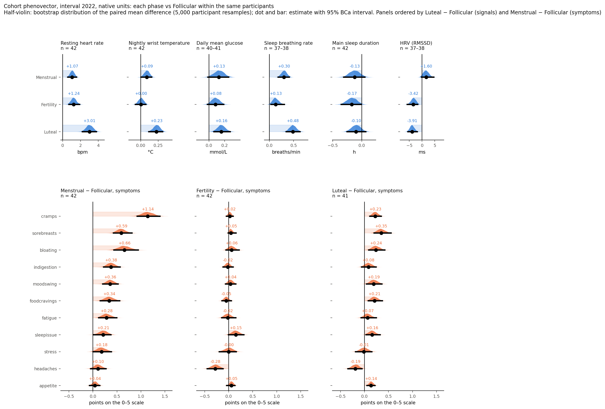
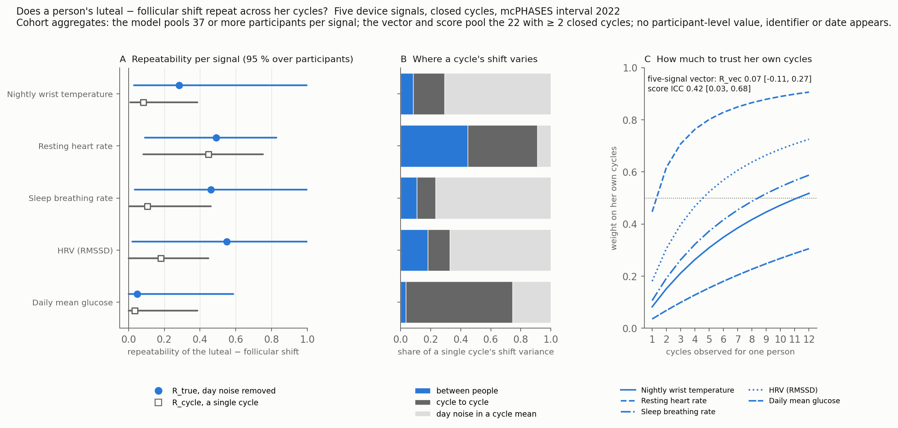

Interval 2022 of the [mcPHASES](https://physionet.org/content/mcphases/1.0.0/) dataset: 42 participants, Fitbit Sense, Dexcom CGM, Mira urine hormones and a daily diary over about three months. Phases come from the hormone-based labels. Every contrast is within the same participants, against their own follicular days, and is reported as an effect size with a 95 % interval. Nothing on this site is participant-level.

::: {.grid}

::: {.g-col-12 .g-col-md-6}
### [Cohort shifts by phase](cohort-shifts.qmd)

Luteal − follicular, same participants: resting heart rate **+3.0 bpm** [2.2, 3.8], wrist temperature **+0.23 °C** [0.12, 0.31], glucose **+0.16 mmol/L** [0.06, 0.27], breathing rate +0.48 /min, HRV −3.9 ms. Menses is the symptom phase: cramps +1.1 points, 41 of 42 participants higher.

:::

::: {.g-col-12 .g-col-md-6}
### [Does a person's shift repeat?](repeatability.qmd)

Yes for resting heart rate: between-person SD **1.9 bpm** [0.7, 2.7] on a 3.0 bpm cohort shift; two of a person's own cycles already outweigh the cohort mean. Barely for wrist temperature: **0.11 °C** [0.04, 0.27] on a 0.28 °C shift, eleven cycles to break even. Over five signals the personal part of the shift vector is small, R_vec 0.07 [−0.11, 0.27].

:::

:::

[Methods](methods.qmd) in one screen · [Prior findings](prior-findings.qmd) on this dataset · aggregate tables in [`tables/`](https://github.com/sangyu/phaseffect/tree/main/tables)
