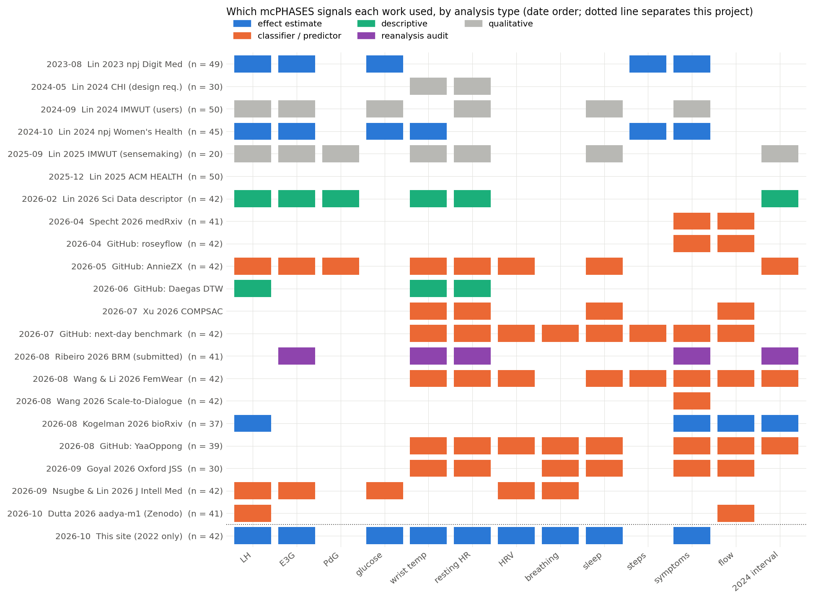
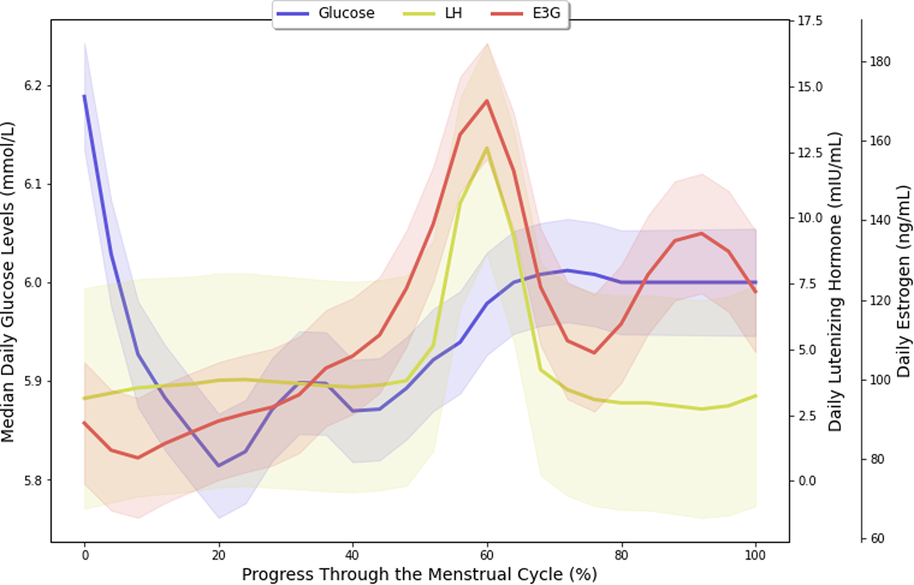
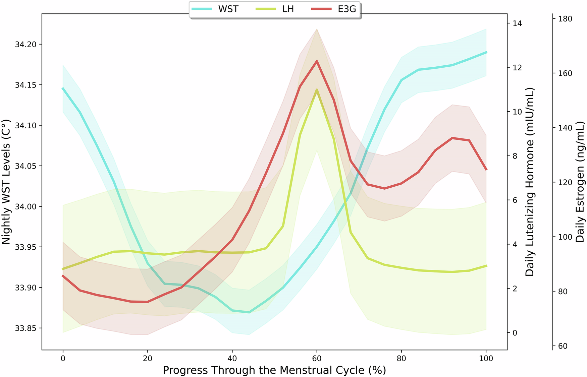
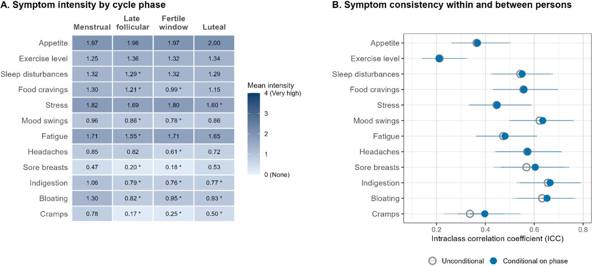
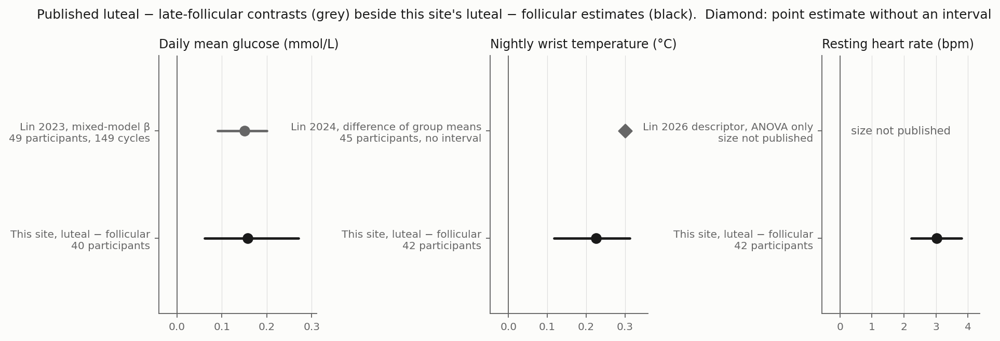

Seventeen formal works and about twenty-five repositories touch the dataset. Everything physiological that is published is a pooled group contrast (glucose, wrist temperature, resting heart rate), a classifier score, or a symptom model. No published work reports a within-person effect with its uncertainty, a cross-signal concordance, or anything anchored on the 2024 progesterone metabolite. This page is the context for the [findings](cohort-shifts.qmd) here; figures reproduced from other works carry their own licence, stated in the caption.

## Inventory

| # | Work | Venue, date | Type | n | Headline number |
|---|---|---|---|---|---|
| 1 | [Lin et al. 2023](https://doi.org/10.1038/s41746-023-00884-x) | npj Digit Med, 2023-08 | effect estimate | 49, 149 cycles | Glucose luteal − late-follicular β = 0.15 [0.09, 0.20] mmol/L |
| 2 | [Lin et al. 2024](https://doi.org/10.1038/s44294-024-00037-9) | npj Women's Health, 2024-10 | effect estimate | 45, 123 cycles | Wrist temperature 34.0 ± 1.0 luteal vs 33.7 ± 0.8 late-follicular; peak 7.6 ± 4.8 d after the LH peak |
| 3 | [Lin et al. 2024, CHI](https://doi.org/10.1145/3613904.3642282) | CHI, 2024-05 | qualitative | 30 | Five design requirements |
| 4 | [Lin et al. 2024, IMWUT](https://arxiv.org/abs/2409.03853) | IMWUT 8(3), 2024-09 | qualitative | 50 | How participants made sense of multimodal tracking |
| 5 | [Lin et al. 2025, IMWUT](https://doi.org/10.1145/3749482) | IMWUT 9(3), 2025-09 | qualitative | 20 | The 2024 return interval as an app study |
| 6 | [Lin et al. 2025, ACM HEALTH](https://doi.org/10.1145/3785664) | ACM Trans Comput Healthc, 2025-12 | qualitative | 50 | Barriers to a holistic view |
| 7 | [Lin 2025, PhD thesis](https://hdl.handle.net/1807/150062) | U Toronto, 2025-10 | qualitative | — | Chapters 3–6 are works 4, 3, 5, 6 |
| 8 | [Lin et al. 2026, descriptor](https://doi.org/10.1038/s41597-026-06805-3) · [PhysioNet](https://physionet.org/content/mcphases/1.0.0/) | Sci Data, 2026-02 | descriptive | 42 (+20) | Repeated-measures ANOVA across phases: temperature F(3, 123) = 11.63, RHR F(3, 123) = 10.26 |
| 9 | [Specht et al. 2026](https://doi.org/10.64898/2026.03.31.26349766) | medRxiv, 2026-04 | classifier | 41 | Symptoms only, four-phase leave-one-subject-out: 67.6 %, macro-F1 0.662; calendar-only 63.0 % |
| 10 | [Xu et al. 2026](https://doi.org/10.1109/COMPSAC69091.2026.00335) | IEEE COMPSAC, 2026-07 | predictor | — | Wearable model beats calendar baselines for next-menses timing; no numbers in the abstract |
| 11 | [Wang & Li 2026, FemWear](https://arxiv.org/abs/2608.08244) | arXiv, 2026-08 | classifier | 42 | Nested leave-one-participant-out phase macro-F1 0.2955 vs 0.2988 baseline |
| 12 | [Wang 2026, Scale-to-Dialogue](https://arxiv.org/abs/2608.08746) | arXiv, 2026-08 | classifier | 42 | Six-item vs three-cluster symptom questioning: QWK 0.976 vs 0.913 |
| 13 | [Kogelman et al. 2026](https://doi.org/10.64898/2026.08.07.743463) | bioRxiv, 2026-08 | effect estimate | 37, 96 cycles | Between-person ICC: cycle length 0.26, late-follicular 0.51, luteal 0.25, menstrual 0.31 |
| 14 | [Ribeiro 2026](https://github.com/8iancachagasribeiro/_signal_pipeline-) | Behav Res Methods, submitted 2026-09 | reanalysis audit | 41 | Heterogeneity of E3G coupling not above a phase-randomised null: RHR p = 0.156, temperature p = 0.874; an earlier p = 0.024 was a join artefact |
| 15 | [Goyal 2026](https://doi.org/10.65161/rec1dcfwy5ynnqavi) | Oxford J Student Scholarship, 2026-09 | classifier | 30 | Bleeding-day ROC-AUC from cycle history alone 0.822; symptoms and wearables did not add |
| 16 | [Nsugbe & Lin 2026](https://doi.org/10.1002/jim4.70057) | J Intell Med, 2026-09 | classifier | 42, 126 cycles | Multimodal − best unimodal: median +0.0156 macro-F1 |
| 17 | [Dutta 2026, aadya-m1](https://doi.org/10.5281/zenodo.23183872) | Zenodo, 2026-10 | forecaster | 41 | An optional LH-test input narrows the 80 % next-period window from ≈ 12 to ≈ 7 days |

Grey literature (repository READMEs, not reproduced): leave-one-subject-out four-phase classifiers in which cycle day carries most of the signal (macro-F1 0.643 from cycle day vs 0.363 from physiology); a 2022 → 2024 distribution shift (KS = 0.322); an LH-aligned clustering of physiology that found no consistent clusters.

## What is established, signal by signal

| Signal | Published finding | Source | Not published |
|---|---|---|---|
| Glucose | Biphasic over the cycle; luteal − late-follicular β = 0.15 [0.09, 0.20] mmol/L | 1 | Per-person size; repeatability |
| Wrist temperature | Group means by phase 33.9 / 33.7 / 33.8 / 34.0 °C; peak 7.6 ± 4.8 d after the LH peak | 2, 8 | Effect in °C with an interval; per-person shift |
| Resting heart rate | ANOVA across phases; lowest in follicular, highest in luteal (boxplots only) | 8 | Any size in bpm |
| HRV, breathing rate, sleep | Classifier features only | 11, 16 | Any phase estimate |
| Phase lengths | Median cycle 31 d; menstrual 6, late-follicular 11, luteal 14; ICCs 0.26 / 0.31 / 0.51 / 0.25 | 13 | — |
| Symptoms | Luteal vs late-follicular on a probit scale: cramps +0.94, sore breasts +0.97, bloating +0.38; symptom ICCs 0.21–0.66 | 1, 13, 9 | — |
| Heterogeneity | Between-person spread of E3G-coupling slopes not larger than a phase-randomised null | 14 | — |
| 2022 → 2024 | Feature distributions shift; physiology-only phase accuracy falls | grey | Any confirmatory use of 2024 |

## Published figures worth knowing

## Published results beside the estimates here

| Signal, luteal − follicular | Published | This site | Agreement |
|---|---|---|---|
| Glucose | β 0.15 [0.09, 0.20] mmol/L, 49 participants | +0.16 [0.06, 0.27], 40 | Same direction and size |
| Wrist temperature | 34.0 vs 33.7 °C, no interval, 45 | +0.23 [0.12, 0.31] °C, 42 | Same direction and size |
| Resting heart rate | F(3, 123) = 10.26, no bpm | +3.0 [2.2, 3.8] bpm, 42 | Direction agrees; size unpublished |
| Breathing rate, HRV | classifier features only | +0.48 /min; −3.9 ms | No published estimate |
| Heterogeneity | E3G-coupling spread not above null | personal shift vector not detectable over 2–3 cycles | Both say person differences are hard to see with few cycles |

## Data hazards reported by prior users

| Hazard | Who reports it | Handling here |
|---|---|---|
| Several Fitbit rows per participant-day; a naive join multiplies observations | Ribeiro audit (p 0.024 → 0.874) | One value per participant-day before any join |
| Resting heart rate 0 means missing; undocumented | Ribeiro; this project | 0 treated as missing |
| Glucose in mg/dL for two participants | GitHub issue on the dataset repository; this project | Converted on the participant's median |
| 2022 and 2024 differ: no diary, PdG added, different RHR export, distribution shift | Descriptor Fig. 2; repositories; Kogelman | 2024 held out |
| Published cohort results use 45–49 participants; 42 released | Dataset authors | Same-direction checks only |
| Symptom diary collected while participants saw their phase predictions | Lin 2024 IMWUT | Symptom contrasts are not blind |
| Phase lengths depend on the labeller | Works 1, 8, 13 | Reference phase stated on every page |

## Licences of the material reproduced here

| Source | Licence | Use on this site |
|---|---|---|
| Lin 2023 | CC BY 4.0 | Figure reproduced with attribution |
| Lin 2024, Lin 2026 descriptor | CC BY-NC-ND 4.0 | One figure reproduced without change, non-commercial |
| Kogelman 2026, Specht 2026 | CC BY | Figure reproduced with attribution |
| arXiv works | CC BY 4.0 | Numbers only |
| Goyal 2026, Nsugbe & Lin 2026, Xu 2026 | not stated or inaccessible | Numbers from the abstract only |
