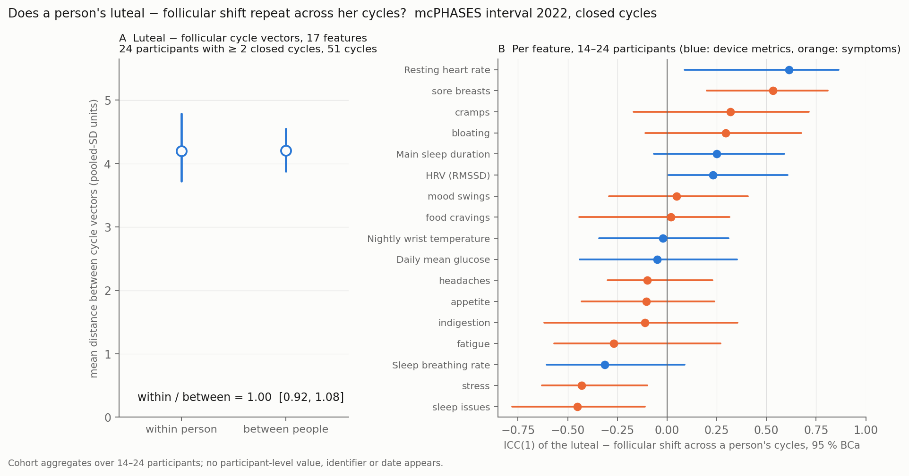

The average contrast is clear; whether people differ persistently in it is not settled. A three-level model of the daily values (person, cycle, day) splits each metric's luteal contrast into its parts. **Resting heart rate** is a candidate: its between-person SD, **1.9 bpm** on a 3.0 bpm cohort contrast, is larger than most simulated cohorts in which nobody differs produce. **The other four metrics are uninformative**: for temperature, breathing rate and HRV the model sits on a boundary (a singular fit), and glucose's estimate is indistinguishable from no difference.

::: {.callout-warning}
## How to read these estimates
- **Intervals are withheld.** A variance cannot go below zero, so its bootstrap interval stays above zero even when people do not differ; in a simulation with no between-person differences, the resting-heart-rate SD came out 0.08 [0.02, 1.72] bpm. Calibrated intervals, from simulations of this exact design, are being computed.
- **Not differing is not the same as sharing.** A between-person estimate that cannot be told from zero means the data are uninformative, not that everyone has the same contrast.
- **A low repeatability does not mean personalization fails.** If everyone shares the same contrast, repeatability is near zero and the shared contrast is the right personal estimate. Whether a person's own history predicts better than the cohort is untested.
:::

```{mermaid}
flowchart LR
    A[42 participants<br/>3,698 labelled days] --> M[Daily values, every closed cycle<br/>37–42 participants per metric]
    M --> V[person · cycle · day<br/>variance components]
    V --> C[calibrated null<br/>in progress]
```


## Per metric

| Metric | Cohort contrast, closed cycles | Between-person SD | Fit | Cycle SD | Day SD | Reading |
|---|---|---|---|---|---|---|
| Resting heart rate (bpm) | +3.0 | **1.9** | interior | 2.0 | 1.7 | candidate |
| Nightly wrist temperature (°C) | +0.28 | 0.11 | singular | 0.17 | 0.58 | uninformative |
| Sleep breathing rate (/min) | +0.53 | 0.18 | singular | 0.19 | 0.93 | uninformative |
| HRV, RMSSD (ms) | −2.5 | 3.1 | near-singular | 2.8 | 12.0 | uninformative |
| Daily mean glucose (mmol/L) | +0.21 | 0.10 | interior | 0.45 | 0.51 | uninformative |

"Singular" means the model's person-level intercept and slope are perfectly correlated, so the person-level slope variance is not identified. The day SD is night-to-night variation around a cycle's phase level; it dominates temperature, where 71 % of a single cycle's contrast variance is day noise.

## The vector across five metrics

Treating each cycle's five-metric contrast as one vector, the distance-based repeatability index R_vec was **0.07 [−0.11, 0.27]** among 22 participants with two or three closed cycles. At this sample size a simulated null spans about ±0.25, and the bootstrap holds the scales fixed, so the interval is too narrow: the index is uninformative.

## Read with

- **Two or three cycles per person**, over about three months; "persistent" means across consecutive cycles, not years.
- **Phases are app labels**, informed by urinary LH and E3G and carried forward when testing stopped; ovulation is not confirmed in 2022, so a person-level difference could reflect anovulatory cycles or label timing rather than physiology.
- **Who is counted.** The model needs closed cycles; 21 to 31 participants per metric have two or more, which favours regular cyclers.
- **Sore breasts**, the one symptom checked, may also carry a persistent difference; symptoms were reported while participants saw the app's phase predictions.
- **Resting heart rate was first flagged** by an earlier, cruder check on the same participants (below), so its candidacy is not an independent replication.
- **Conflicting evidence.** In a large WHOOP cohort, the person-to-person spread of a raw resting-heart-rate cycle amplitude was about the same in pill users, who have no hormonal cycle, as in natural cyclers (about 1.9 bpm; [Jasinski et al. 2024](https://doi.org/10.1038/s41746-024-01394-0)). Raw spread of that size can be mostly noise, which is why the candidacy here rests on the calibrated null, not on the 1.9 bpm itself.
- **Method.** R_vec is the distance-based ICC of [Xu, Reiss & Cribben (2021)](https://doi.org/10.1111/biom.13287); recommended designs for random-slope repeatability use far more people and more than two occasions per person, so every estimate here is underpowered.

## The earlier check: 17 features on the between-person scale

Before the model above, a cruder check put all 17 features (six device metrics and eleven symptoms) on a common scale, the between-person spread of phase means, and asked whether a person's cycle vectors lie closer to each other than to other people's. They did not: ratio 1.00 [0.92, 1.08] over 24 participants. On that scale a consistent 3 bpm shift against baselines that differ by 7 bpm between people counts for less than a one-point symptom shift, and symptom noise swamps the device metrics. Per feature, resting heart rate had the largest device-metric ICC (0.61 [0.09, 0.86], 14 participants); HRV (0.23 [0.01, 0.61]) and sore breasts (0.53 [0.20, 0.81]) also had intervals above zero, and temperature did not (−0.02 [−0.34, 0.31]). None of these lower limits is a test.



Tables: [`tables/rep03_components.csv`](tables/rep03_components.csv), [`tables/rep03_summary.json`](tables/rep03_summary.json); the earlier check's [`tables/feature_icc.csv`](tables/feature_icc.csv) and [`tables/repeatability_summary.json`](tables/repeatability_summary.json).
